# Enterprise IT Support AI Copilot - Architecture

## Discovery scope and evidence

This document describes the current repository implementation, not a proposed
future-state system. It is based on the source files, dependency manifest,
Dockerfile, and README in this repository. Where the requested architecture
detail is not implemented or cannot be established from those sources, it is
marked **Not found in codebase**. Recommendations are labeled as such.

Secrets and credential values are intentionally excluded. The root `.env` is
ignored by Git and is not an architecture artifact. The README contains some
older technology and setup descriptions that conflict with current imports;
the implementation is treated as authoritative below.

## 1. Executive summary

This application is a web-based IT support copilot. It accepts employee
questions, retrieves company knowledge from Pinecone, evaluates whether that
evidence is sufficient, and can fall back to Tavily web search. LangGraph
orchestrates routing, retrieval, evidence grading, query rewriting, and answer
generation. FastAPI exposes the chat, health, and document-ingestion endpoints.

The README frames the business problem as reducing repetitive internal IT
support questions by making policies and runbooks easier to find. It describes
NovaRetail as a fictional demonstration customer. Intended users are employees
asking IT support questions and an administrator who uploads knowledge files.

**Current capabilities**

- Browser chat UI with answer source, citations, and visible workflow trace.
- Direct conversational answers for greetings and similar messages.
- Private-KB-first RAG with web fallback and a bounded rewrite/retry path.
- Ingestion of PDF, TXT, Markdown, and DOCX files.
- SQLite audit rows for chat question, selected source, timestamp, and trace.
- Health endpoint and a Docker image definition.

**Technical objectives evidenced by code** are grounded answers, source
selection, a small HTTP surface, and configurable external services. Business
success measures, service-level objectives, production deployment targets, and
measured quality or cost targets are **Not found in codebase**.

## 2. Functional overview

### Main user journeys

1. A user opens `/` and submits a question in the browser.
2. The browser sends JSON to `POST /api/chat`.
3. The graph routes the question to direct response or private retrieval.
4. If private evidence is weak, it searches the web and grades the result.
5. If web evidence is weak and the retry budget remains, it rewrites the query
   and returns to private retrieval. Otherwise, it returns an insufficient
   evidence response.
6. The API writes an audit row and returns the answer, source, trace, citations,
   and rewritten query.
7. An authorized operator uploads a supported document through `POST
   /api/ingest`; the API loads, chunks, embeds, and adds it to Pinecone.

### Features and non-functional behavior

| Area | Implemented behavior |
|---|---|
| Chat | Synchronous request/response; question length 2-3000 characters. |
| Retrieval | Pinecone vector search with configured namespace and `top_k`. |
| Web | Tavily fallback; up to five results are requested. |
| Ingestion | Local upload copy plus Pinecone vector insertion. |
| Audit | Local SQLite table; chat question, source, trace, UTC timestamp. |
| UI | Static HTML/CSS/JavaScript served by FastAPI. |
| Availability, latency, throughput targets | Not found in codebase. |
| Rate limiting, background execution, streaming | Not found in codebase. |

## 3. System context

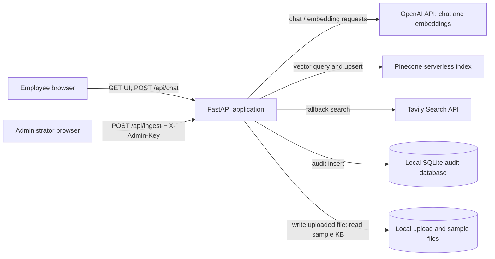

**Boundaries.** The browser-to-API path is HTTP in the documented local
development setup. The application process is the only implemented server
boundary. OpenAI, Pinecone, and Tavily are external network dependencies.
SQLite and uploaded/sample files are local filesystem resources. Pinecone is
configured in `app/rag/vectorstore.py` for AWS `us-east-1`; this is the
Pinecone service region, not evidence that the application itself is deployed
on AWS.

An API gateway, message queue, enterprise identity provider, separate
authentication service, and external relational database are **Not found in
codebase**.

## 4. High-level design

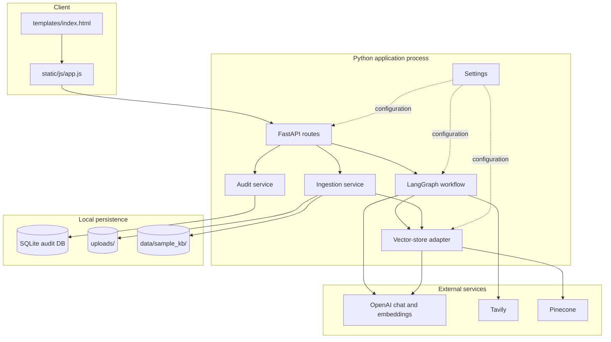

| Layer | Current component and responsibility |
|---|---|
| Client | `templates/index.html`, `static/js/app.js`, `static/css/style.css`. |
| Frontend | Sends chat JSON and multipart uploads; renders trace, citations, and errors. |
| API | `app/api/routes.py`; health, chat, and ingestion. |
| Gateway | No gateway or API management layer found. |
| Business/orchestration | `app/rag/workflow.py`; LangGraph nodes and conditional edges. |
| Ingestion | `app/services/ingestion.py`; file loading and recursive chunking. |
| Retrieval | `app/rag/vectorstore.py`; OpenAI embeddings and Pinecone integration. |
| Persistence | SQLite audit rows; Pinecone vectors; local upload files. |
| Observability | Basic Python logging and audit table only. Metrics/tracing not found. |
| Infrastructure | `Dockerfile` and local `run.py`; cloud deployment infrastructure not found. |

## 5. Low-level design

| Module / symbol | Inputs and outputs | Dependencies / consumers | Execution |
|---|---|---|---|
| `app/main.py` `app`, `home` | HTTP request to HTML response | FastAPI, router, templates, logging, audit initialization | Import-time app setup; serves `/`. |
| `app/api/routes.py` `ChatRequest` | Pydantic question, 2-3000 chars | Pydantic, workflow, vectorstore, ingestion, audit | Request validation before handler. |
| `health()` | No input; status/service JSON | Settings | `GET /api/health`. |
| `chat(payload)` | Question; answer/source/trace/citations/query JSON | `ask`, `write_audit` | `POST /api/chat`. |
| `ingest(file, x_admin_key)` | Multipart file and header; file/chunk/ID result | Ingestion, vectorstore | `POST /api/ingest`. |
| `app/rag/state.py` `AgentState` | Typed graph state | LangGraph, LangChain `Document` | Shared state schema for graph nodes. |
| `RouteDecision`, `EvidenceGrade` | Structured route and evidence labels | Pydantic | LLM structured-output schemas. |
| `app/rag/workflow.py` `build_graph`, `ask` | Question to graph-state/result | LangGraph, ChatOpenAI, Tavily, retriever | Graph compiled at module import; invoked per chat. |
| `llm()`, `web_search_tool()` | No arguments; lazily cached clients | OpenAI and Tavily keys/settings | First node requiring each provider. |
| Graph nodes | `AgentState` updates | LLM, retriever, Tavily | Conditional state transitions described in sections 11-13. |
| `app/rag/vectorstore.py` `ensure_index` | Settings; Pinecone index handle | Pinecone SDK | Called when vector store/retriever is first needed. |
| `get_embeddings`, `get_vectorstore` | No arguments; cached embedding/store | OpenAIEmbeddings, PineconeVectorStore | Lazy singleton-like module globals; no synchronization. |
| `app/services/ingestion.py` `load_file` | File path; LangChain Documents | PyPDFLoader, TextLoader, python-docx | Called after upload save or by sample ingestion script. |
| `chunk_documents` | Documents; split Documents | RecursiveCharacterTextSplitter | 900-character chunks, 120-character overlap. |
| `app/services/audit.py` `init_db`, `write_audit` | Schema setup or chat data; no return data | sqlite3, settings | `init_db` during app import; write after successful `ask`. |
| `app/core/config.py` `Settings`, `get_settings` | Environment and defaults; cached settings | Pydantic Settings | Settings loaded from root `.env` or process environment. |
| `app/core/logging.py` `configure_logging` | No arguments | Python logging | Called by `app/main.py` on import. |
| `run.py` | `HOST`, `PORT` environment variables | Uvicorn | Development runner, reload enabled. |

There is no explicit repository abstraction, service container, middleware
stack, response DTO class, or dependency-injection layer. API request validation
is explicit only for `ChatRequest`; the other endpoint uses FastAPI's
`UploadFile`/`File`/`Header` parameters.

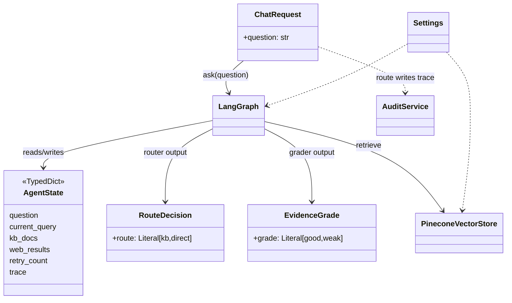

## 6. Repository structure analysis

Criticality is an architectural estimate, not a measured risk score.

| File or path | Purpose / why it exists | Used by / dependencies | Criticality; impact if removed |
|---|---|---|---|
| `app/main.py` | Creates FastAPI app, configures logging, initializes audit DB, registers router/static/templates. | Uvicorn; FastAPI; `app/api/routes.py`; audit service. | Critical; app startup and UI fail. |
| `app/api/routes.py` | HTTP handlers and chat request schema. | Browser; workflow; ingestion; vectorstore; audit. | Critical; API features fail. |
| `app/api/__init__.py` | Re-exports router. | `app/main.py`. | High; router import path breaks. |
| `app/core/config.py` | Settings, defaults, root path, cached environment loading. | Most backend modules. | Critical; configuration unavailable. |
| `app/core/__init__.py` | Package marker. | Python package imports. | Low. |
| `app/core/logging.py` | Basic logging format and level. | `app/main.py`. | Low; app still runs without configured format. |
| `app/rag/state.py` | Agent graph state and structured output models. | `workflow.py`. | Critical; workflow schema imports fail. |
| `app/rag/workflow.py` | Routing, retrieval, grading, web fallback, rewriting, generation. | Chat API; LangGraph; OpenAI; Tavily; vectorstore. | Critical; chat fails. |
| `app/rag/vectorstore.py` | Embedding, index ensure/connect, retrieval and document insertion. | Workflow and ingestion. | Critical; RAG and ingestion fail. |
| `app/rag/__init__.py` | Package marker. | Python package imports. | Low; namespace-package behavior may vary. |
| `app/services/ingestion.py` | Supported file loaders and chunking. | Ingest API and sample ingestion. | High; file ingestion fails. |
| `app/services/audit.py` | SQLite schema and audit insert. | App startup and chat API. | High; startup or chat audit path fails. |
| `app/services/__init__.py` | Package marker. | Python package imports. | Low. |
| `templates/index.html` | Browser UI and upload/chat elements. | FastAPI/Jinja2 and `app.js`. | High; home page fails. |
| `static/js/app.js` | Chat/upload fetch calls and UI rendering. | HTML elements and API endpoints. | High; interactions fail. |
| `static/css/style.css` | Layout and presentation. | HTML. | Low; UI styling disappears. |
| `data/sample_kb/company_it_handbook.md` | Demo company knowledge source. | `ingest_sample_kb.py`. | Medium; this sample content is unavailable for ingestion. |
| `data/sample_kb/service_desk_runbook.md` | Demo support runbook source. | `ingest_sample_kb.py`. | Medium; this sample content is unavailable for ingestion. |
| `data/audit.db` | Runtime local audit database if present. | Audit service. | Runtime state; deletion loses audit history. |
| `uploads/` | Runtime copies of uploaded files. | Ingest API. | Runtime data; deletion removes local originals, not necessarily vectors. |
| `ingest_sample_kb.py` | Loads all files in configured sample folder and adds chunks to Pinecone. | Settings, ingestion, vectorstore. | Medium; manual sample import unavailable. |
| `run.py` | Local Uvicorn development entry point. | Uvicorn; `app.main:app`. | Medium; use Uvicorn directly as alternative. |
| `requirements.txt` | Python dependency versions. | Installation and Docker build. | Critical for reproducible setup. |
| `Dockerfile` | Builds and starts a Python 3.11 container. | Docker; requirements. | Medium; container workflow unavailable. |
| `.gitignore` | Excludes `.env`, virtualenvs and generated files. | Git. | Medium; secrets/generated files may be accidentally tracked if removed. |
| `README.md` | User-facing setup, demo, and API guidance. | Engineers/operators. | Low at runtime; setup guidance becomes unavailable. Some parts are stale. |
| `create_project.py` | Creates listed directories and empty placeholder files in current directory. | Manual invocation only. | Low; no runtime dependency. |
| `docs/FDE_Agentic_RAG_Problem_Statement.pdf` | Project reference document. | No runtime import found. | Low at runtime. |
| `docs/Forward_Deployed_Engineer_Explained.pptx.pdf` | Project reference document. | No runtime import found. | Low at runtime. |
| `LICENSE` | Repository license. | Repository users. | No runtime dependency. |
| `tests/test_vectorstore.py` | Focused ensure-index tests in the current workspace. | `unittest`, mocked Pinecone client. | Test-only; no runtime dependency. |

No CI pipeline, lockfile, Alembic migration, `docker-compose.yml`,
`.dockerignore`, `pyproject.toml`, or `.env.example` is present in the tracked
file inventory. `uploads/` and the root `.env` are environment/runtime data;
their contents are deliberately not reproduced here.

## 7. Startup sequence

1. `run.py` reads `HOST` (default `127.0.0.1`) and `PORT` (default `8000`) and
   calls Uvicorn with reload enabled.
2. Uvicorn imports `app.main:app`.
3. `app.main` imports the API router and config; import chains load settings.
4. `configure_logging()` configures standard Python logging at INFO.
5. `init_db()` creates the SQLite `query_audit` table if absent.
6. `FastAPI` is instantiated, the API router and `/static` mount are registered,
   and Jinja templates are configured.
7. `workflow.py` compiles the LangGraph at module import. Chat and web clients
   are lazy; the Pinecone client/index and embeddings are not proactively
   initialized during app startup.

No explicit lifespan handler, application startup/shutdown event, cache
initialization, background worker, or service registry is found.

```mermaid
sequenceDiagram
    participant R as run.py / Uvicorn
    participant M as app.main
    participant C as Settings
    participant L as Logging
    participant D as Audit SQLite
    participant A as API router
    participant G as LangGraph
    R->>M: import app.main:app
    M->>C: get_settings()
    M->>L: configure_logging()
    M->>D: init_db()
    M->>A: include_router(router)
    A->>G: import workflow; build_graph()
    M-->>R: FastAPI app ready
    Note over M,G: LLM, Pinecone, and Tavily clients remain lazy
```

## 8. Request lifecycle and API

### `GET /api/health`

`app/main.py` registers `app/api/routes.py:health`. It returns
`{"status":"ok","service":...}` from settings. It does not check SQLite,
OpenAI, Pinecone, or Tavily connectivity.

### `POST /api/chat`

Request JSON is validated by `ChatRequest` (`question` length 2-3000). The
route calls `ask(question)`, writes an audit row, and returns `answer`,
`source_used`, `trace`, `citations`, and `rewritten_query`. Any caught exception
is returned as HTTP 500 with its string detail.

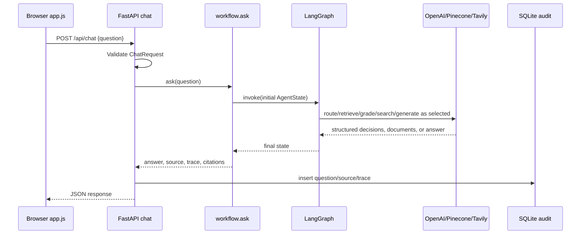

### `POST /api/ingest`

`app/api/routes.py:ingest` checks the `X-Admin-Key` header using direct string
equality with `settings.admin_api_key`. It checks the filename suffix against
`.pdf`, `.txt`, `.md`, `.docx`; writes the full request body to `upload_dir`
using the basename; loads and chunks it; calls `add_documents`; then returns
the filename, chunk count, and generated IDs.

### OpenAPI-style summary

| Method / route | Authentication | Request | Success response | Explicit errors / dependencies |
|---|---|---|---|---|
| `GET /api/health` | None | None | 200 status and service name | No dependency health checks. |
| `POST /api/chat` | None | JSON `{"question": string}` | 200 answer, source, trace, citations, rewritten query | Pydantic validation 422; caught workflow/audit errors 500. |
| `POST /api/ingest` | Shared `X-Admin-Key` | Multipart `file` | 200 message, filename, chunks, IDs | Invalid key 401; unsupported extension 400; missing file/schema 422; downstream errors are not explicitly translated. |
| `GET /` | None | Browser request | HTML from `templates/index.html` | Template/static configuration. |

No versioned API prefix beyond `/api`, custom OpenAPI response schemas, request
rate limits, CORS configuration, or pagination is found.

## 9. End-to-end data flow

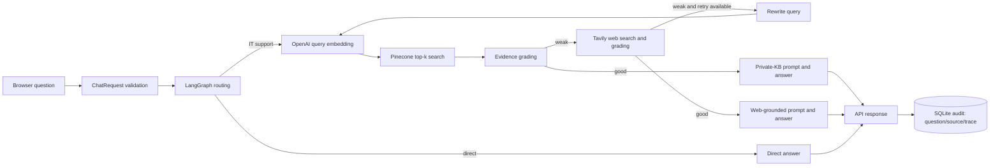

For ingestion, uploaded bytes are written to local disk, parsed into LangChain
`Document` objects, split into 900-character chunks with 120-character
overlap and start-index metadata, embedded through `OpenAIEmbeddings`, then
stored in the configured Pinecone namespace. Source paths are carried as
document metadata where loaders provide them. No explicit data encryption,
retention, deletion, or vector re-index workflow is implemented.

## 10. Runtime flow analysis

The Uvicorn web server is the only continuously running application process.
Each chat runs synchronously through the graph in the request path. Ingestion
is an async FastAPI handler but reads and processes the complete upload before
responding; it does not enqueue a background job.

`ingest_sample_kb.py` is a manually invoked script, not a scheduled task.
Background workers, scheduled jobs, queues, periodic cleanup, cache refresh,
and upload deletion are **Not found in codebase**.

## 11. AI/LLM architecture

- Provider: `ChatOpenAI` from `langchain_openai`, configured with
  `OPENAI_MODEL` (default `gpt-4o-mini`), temperature 0, and `OPENAI_API_KEY`.
- Prompts are inline strings in `app/rag/workflow.py`; there are no external
  prompt templates or prompt version store.
- Routing and evidence grading use LangChain structured output with the
  `RouteDecision` and `EvidenceGrade` Pydantic models.
- Query rewriting calls the same chat model and strips the returned content.
- Answer generation includes the original question plus private documents or
  web evidence. The system prompt instructs against unsupported claims.
- Tokenization and provider-side context limits are handled by provider
  libraries/services; application token counting and context budgeting are
  **Not found in codebase**.
- Chat model and search clients are cached in module globals after first use.

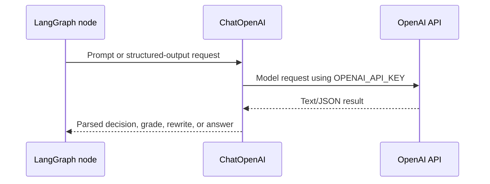

The README's older references to Groq as the chat provider and HuggingFace
embeddings do not match current runtime imports. `langchain-groq`,
`langchain-huggingface`, and `sentence-transformers` appear in
`requirements.txt`, but no runtime imports of those providers were found.

## 12. RAG architecture

### Ingestion

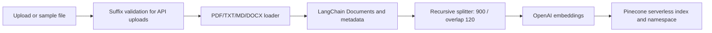

`PyPDFLoader` loads PDFs; `TextLoader` loads TXT/MD as UTF-8; `python-docx`
extracts non-empty paragraphs. The API accepts only the listed suffixes; the
sample script iterates every file in `sample_kb_dir` without an extension
filter. OCR, table extraction, document malware scanning, deduplication, and
metadata schema enforcement are **Not found in codebase**.

The configured embedding model defaults to `text-embedding-3-small`; the
dimension table maps it to 1536. `ensure_index()` creates a missing cosine
serverless index on AWS `us-east-1`, waits until ready, checks existing index
dimension, and returns `pc.Index(...)`. It refuses a dimension mismatch instead
of deleting/recreating the existing index.

### Query

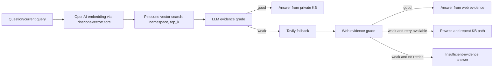

An explicit reranker, hybrid keyword search, query filters, access-control
metadata filters, conversation history, and long-term memory are **Not found in
codebase**. Retrieval uses `top_k` (default 4) and the configured namespace.

## 13. Agent architecture

There is one LangGraph workflow, not a multi-agent system. Its nodes are
`route_question`, `retrieve_kb`, `grade_kb`, `search_web`, `grade_web`,
`rewrite_query`, `generate_from_kb`, `generate_from_web`, `direct_answer`, and
`insufficient`. Conditional edges choose the next node based on structured
route/grade values and `retry_count`. The retry budget is `MAX_RETRIES`
(default 1). The state contains the question, current query, documents,
web-result text, grades, answer, source, retry count, trace, and citations.

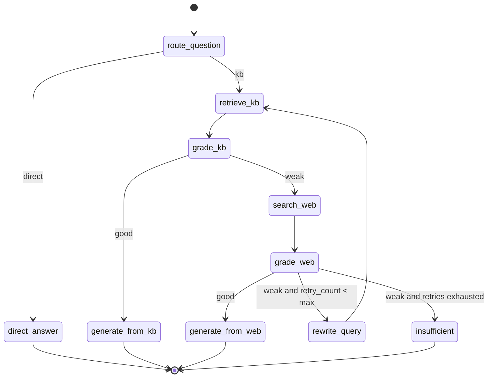

Tool execution is limited to retriever access and Tavily search inside graph
nodes. Separate agent roles, agent-to-agent messaging, durable memory, and
planning beyond the conditional state graph are **Not found in codebase**.

## 14. MCP architecture

MCP clients, servers, resources, prompts, tools, and transports are **Not found
in codebase**. The project uses LangGraph and LangChain tools directly; that is
not MCP.

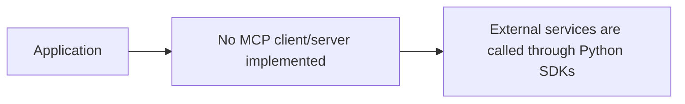

## 15. Database design

Only the audit database is implemented locally. Pinecone is a managed vector
index, not a relational database controlled by application migrations.

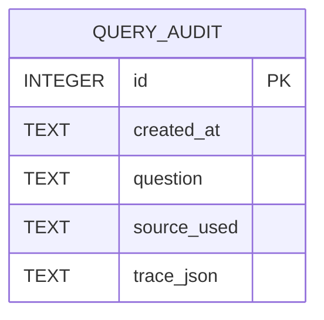

`query_audit` is created by `init_db()` using `CREATE TABLE IF NOT EXISTS`.
`id` is an autoincrement primary key; the other fields are non-null. No other
tables, foreign keys, secondary indexes, triggers, migration framework, or
relationships are found. Answers, citations, and rewritten queries are not
stored by `write_audit()`. The local SQLite file is configured by
`AUDIT_DB_PATH`, defaulting to `data/audit.db`.

Pinecone index name, dimension, metric, cloud, region, and namespace are
configured through code/settings. Vector metadata is inherited from loaded
documents; a separate metadata schema is **Not found in codebase**.

## 16. Dependency graph analysis

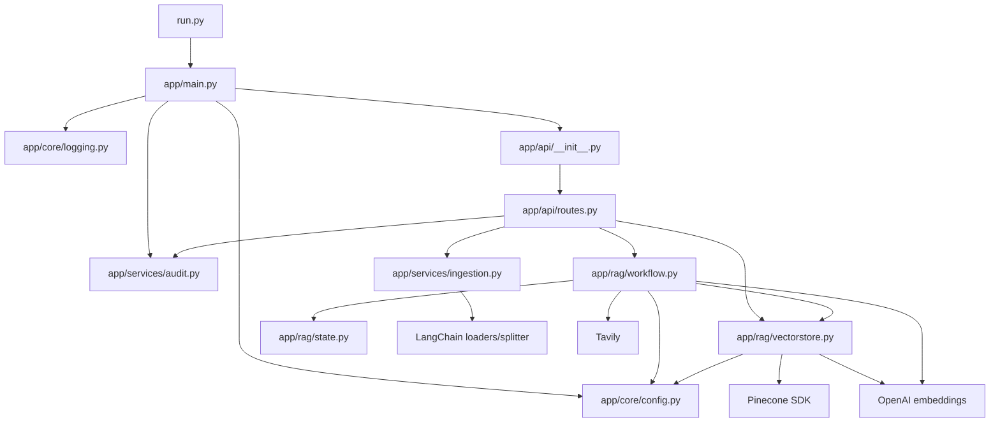

The chat route directly couples HTTP handling to orchestration and audit
storage. The ingestion route directly coordinates disk I/O, parsing, chunking,
and vector insertion. Settings are captured at module import in several
modules, making runtime mutation difficult. No import cycle was identified in
the inspected import graph. The in-memory global clients/stores are not
explicitly synchronized for concurrent initialization.

## 17. API documentation

See section 8 for request/response details. FastAPI supplies `/docs` and
`/openapi.json` from registered routes. No custom API versioning, response
models, or explicit error schema is defined. The browser uses `fetch()` against
same-origin `/api/chat` and `/api/ingest`.

## 18. Configuration analysis

Settings are defined in `app/core/config.py` with Pydantic Settings,
`env_file` pointing to the repository-root `.env`, `extra="ignore"`, and an
`lru_cache` around `get_settings()`. Process environment variables may override
file values. Values below are code defaults, not secret values.

| Variable | Code default | Required / impact if missing | Security / operational note |
|---|---|---|---|
| `APP_NAME` | `Enterprise IT Support Agentic RAG Copilot` | Optional; health/UI label. | Non-secret. |
| `APP_ENV` | `development` | Optional; currently not used for behavior selection. | No environment-specific hardening found. |
| `OPENAI_API_KEY` | Empty | Required for chat and embeddings; missing key raises runtime error when client is requested. | Secret; never commit or log. |
| `TAVILY_API_KEY` | Empty | Required only when web fallback is used. | Secret. |
| `PINECONE_API_KEY` | Empty | Required for index/retrieval/vector insertion. | Secret. |
| `PINECONE_INDEX_NAME` | `industry-agentic-rag-kb-v2` | Optional if this index is desired; wrong name points to another/missing index. | Validate against vector dimension before deployment. |
| `PINECONE_NAMESPACE` | `langgraph-agentic-rag` | Optional; mismatched namespace appears empty to retrieval. | Logical data partition only; not user authorization. |
| `EMBEDDING_MODEL` | `text-embedding-3-small` | Required for dimension selection and embedding client configuration. | Dimension must match index. |
| `OPENAI_MODEL` | `gpt-4o-mini` | Needed for LLM calls. | Provider-side model availability/cost applies. |
| `TOP_K` | `4` | Optional; controls retrieval count. | No bounds validation found. |
| `MAX_RETRIES` | `1` | Optional; controls workflow retry. | No bounds validation found. |
| `ADMIN_API_KEY` | `change-me` | Must be overridden for a protected ingestion endpoint. | Insecure default; shared static secret, direct comparison. |
| `AUDIT_DB_PATH` | `data/audit.db` | Optional; parent directory must be writable. | Audit data may contain sensitive questions. |
| `UPLOAD_DIR` | `uploads` | Optional; must be writable. | Stores uploaded originals without cleanup. |
| `SAMPLE_KB_DIR` | `data/sample_kb` | Used by manual sample ingestion script. | Missing directory causes script failure. |
| `HOST`, `PORT` | `127.0.0.1`, `8000` in `run.py`; Docker uses port 8080 | Optional listener settings. | Local runner binds loopback by default; container binds all interfaces. |

No feature flag framework, secret manager integration, schema validation for
deployment environments, or checked-in `.env.example` is found. The
`requirements.txt`/README examples should be reconciled with the actual code
defaults before using them as deployment configuration.

## 19. Security architecture and threat model

### Current controls

- `.env` is excluded by `.gitignore`; no secret values are included in this
  document.
- Chat questions have a length constraint and Pydantic validation.
- Upload suffixes are checked; the stored path uses the uploaded basename.
- Frontend text is HTML-escaped before insertion, and citation links use
  `rel="noopener"`.
- SQLite audit values use parameterized SQL.
- Private-KB and web-answer prompts instruct the model to ground answers in the
  supplied evidence.

### Threats and gaps

| Threat | Current evidence / gap | Recommended mitigation |
|---|---|---|
| Unauthorized ingestion | Shared `X-Admin-Key`; default is `change-me`; ordinary string comparison; no identity/RBAC. | Require high-entropy secret, rotate it, use constant-time comparison or identity provider, restrict endpoint at network layer. |
| Secret exposure | `.env` ignored by Git, but Dockerfile copies build context and no `.dockerignore` is tracked. | Add `.dockerignore`; inject secrets at runtime using a secret manager; scan image and repository. |
| Upload abuse / denial of service | Full file read/write, no size/page/chunk limits, content checks, or request throttling. | Enforce request/body/page/chunk limits, validate file signatures, scan files, rate-limit, isolate parsing. |
| Path and file overwrite | Basename prevents directory traversal, but repeated names overwrite the local file. | Use generated storage names and safe retention policy. |
| Prompt injection / poisoned KB | Retrieved text is inserted into prompts; no trust labeling or injection detector. | Treat retrieved/web text as untrusted data; test adversarial documents; require source policy and human review. |
| Data leakage | Chat handler returns exception text; audit stores raw question and trace; no retention controls. | Return generic external errors, sanitize logs, define retention and access controls. |
| SSRF | No arbitrary-URL fetch endpoint found; web search uses Tavily. | Maintain egress allowlists and avoid adding arbitrary URL loaders without controls. |
| SQL injection | Audit inserts are parameterized; no dynamic SQL found. | Preserve parameterization. |
| Transport / browser security | Local README uses HTTP; TLS, CSP, CSRF controls, CORS policy, and security headers not found. | Terminate TLS at a trusted proxy; set security headers and deployment-specific CORS/CSRF policy. |
| Model abuse / cost exhaustion | No auth on chat, rate limits, quotas, or token budgets found. | Add user auth, request quotas, token/context budgets, and provider spend alerts. |

No formal threat model, security tests, RBAC, enterprise identity integration, or
compliance controls are found.

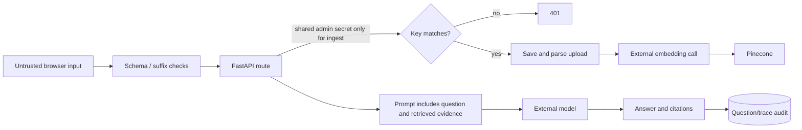

## 20. Error handling architecture

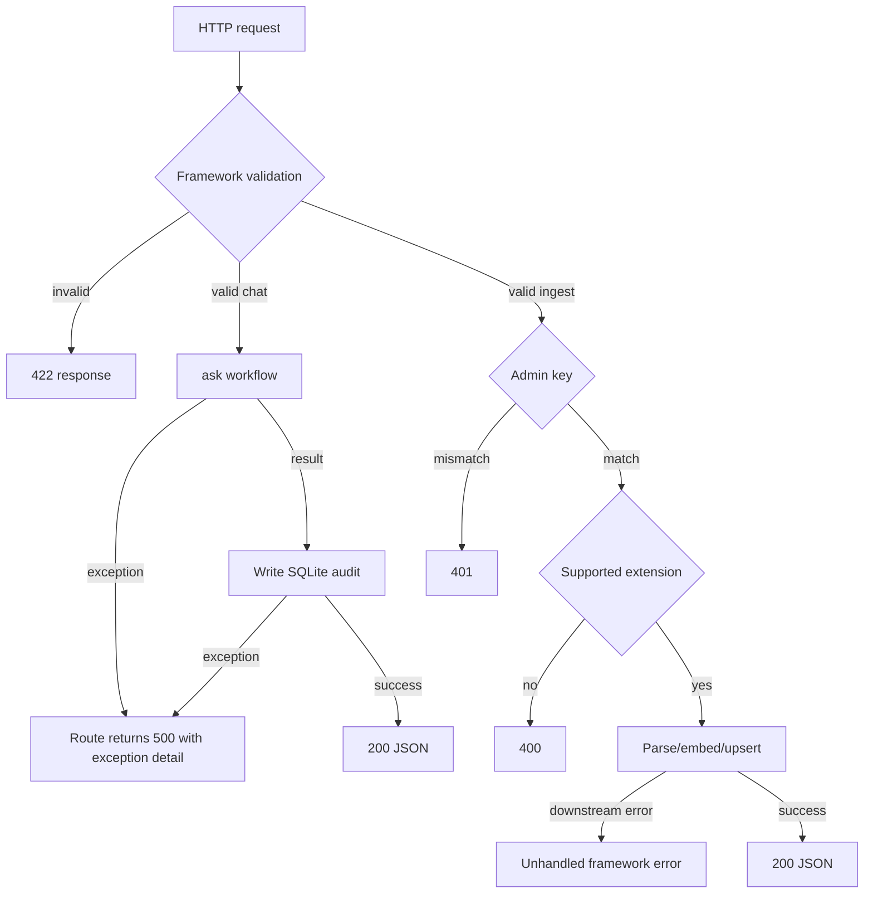

Missing credentials and unsupported embedding names raise explicit runtime or
value errors in the relevant helper. Existing-index dimension mismatch raises
without deleting the index. Index creation polls readiness every second with no
timeout. Explicit retries for provider failures, timeout configuration,
circuit breakers, or transient-error mapping are **Not found in codebase**.
LangGraph's query rewrite is a relevance retry, not a general network retry.

## 21. Logging and observability

`configure_logging()` configures Python logging to INFO with timestamp, level,
logger name, and message. A logger is defined in `workflow.py`, but operational
metrics, trace IDs, request logs, dashboards, and alert rules are not found.
Agent trace strings are returned to the browser and persisted with each chat
audit record; they are not distributed traces.

Recommended signals: request counts/latency/status by route; model and
embedding latency/token usage; Pinecone and Tavily errors/latency; workflow
branch/retry counts; ingestion size/chunk counts; SQLite errors; key/provider
quota and spend. Avoid logging credentials or raw sensitive content.

## 22. Performance analysis

No benchmark or production telemetry is present. Likely latency components are
sequential model route, embedding/vector search, evidence grader, optional
Tavily call, and answer generation. Rewriting adds another retrieval cycle.
Uploads are read fully into memory and parsed/chunked in the request. The graph
and LLM calls are synchronous; concurrent request capacity depends on Uvicorn
and deployment configuration.

Potential improvements (not implemented): measure each stage; cap upload bytes
and page/chunk counts; use bounded async/background ingestion for large files;
reuse HTTP clients through supported SDK lifecycle patterns; add timeouts and
provider retries; tune `TOP_K`; bound prompt context; cache only where
freshness/privacy allow. No CPU/memory profiling data is found.

## 23. Scalability analysis

The API has no explicit per-user session state, but contains module-global
clients and stores. SQLite is local to one filesystem and is not configured for
multi-instance coordination. Uploads are local, while vectors are in managed
Pinecone. No load balancer, worker tier, shared filesystem, cache, database
service, or autoscaling config is found.

Pinecone can be operated as a separate managed service, but application
throughput, index sizing, quotas, and scaling policy are not specified.
Horizontal app replicas would require deliberate handling of SQLite/audit
storage, uploads, settings, and singleton initialization. Production autoscale
architecture is **Not found in codebase**.

## 24. AI cost analysis

Exact cost per request cannot be calculated from this repository: token counts,
usage volumes, provider price assumptions, Pinecone capacity/usage, and Tavily
plan are **Not found in codebase**.

Cost components are: OpenAI chat calls for routing/grading/generation and
optional rewrite; OpenAI embedding calls for ingestion and retrieval;
Pinecone vector storage/query; and Tavily searches on weak KB evidence. Direct
greetings avoid Pinecone and Tavily but still call the chat model. Cost
optimization opportunities include avoiding duplicate model calls where safe,
limiting prompt size and top-k, reducing unnecessary web fallback, setting
provider budgets, and tracking usage by route.

## 25. Failure scenario analysis

| Failure | Current behavior | Recommended behavior |
|---|---|---|
| API process unavailable | Browser request fails; no alternate API path found. | Health monitoring, restart policy, graceful maintenance response. |
| OpenAI unavailable/key missing | Runtime exception; chat route maps caught exceptions to 500. | Timeouts, bounded retries, sanitized error and alerting. |
| Pinecone unavailable/key missing | Retrieval/ingestion fails; chat returns 500; ingestion error is not specially mapped. | Dependency health checks, bounded retry, clear service-unavailable status. |
| Index absent | `ensure_index()` attempts creation and waits for ready. | Provision index explicitly in deployment and configure a finite wait timeout. |
| Existing index dimension mismatch | Explicit error; existing index is preserved. | Operator runbook to migrate to a new compatible index/model. |
| Tavily unavailable/key missing | Web fallback raises; chat route returns 500. | Handle fallback failure and return safe insufficient-evidence response. |
| SQLite unavailable/unwritable | `init_db()` may prevent startup; audit insert failure turns chat into 500. | Separate audit failure policy, health check, backup/retention. |
| Upload parsing fails | Error propagates through framework; behavior may leave saved file behind. | Cleanup on failure and explicit 4xx/5xx mapping. |
| Network failure | No explicit timeout/retry/circuit breaker found. | Client timeouts, retry only safe operations, telemetry. |
| Authentication provider fails | No provider exists in the implementation. | Not applicable until an identity provider is introduced. |
| PostgreSQL/Redis/queue fails | Those components are not used. | Not applicable to current system. |

## 26. Deployment architecture

**Local:** README documents a virtual environment and `run.py`; default bind is
`127.0.0.1:8000`, reload enabled. The root `.env` configures providers.

**Container:** `Dockerfile` uses `python:3.11-slim`, installs
`requirements.txt`, copies the build context, exposes 8080, and starts Uvicorn
on `0.0.0.0`. No `.dockerignore` is present in the tracked inventory, so build
context hygiene needs attention.

**Development/QA/UAT/production:** Separate environment definitions, cloud
resource manifests, container registry configuration, and deploy workflows are
**Not found in codebase**. Azure, AWS application hosting, Kubernetes, and
CI/CD deployment are not established by the Pinecone AWS region setting.

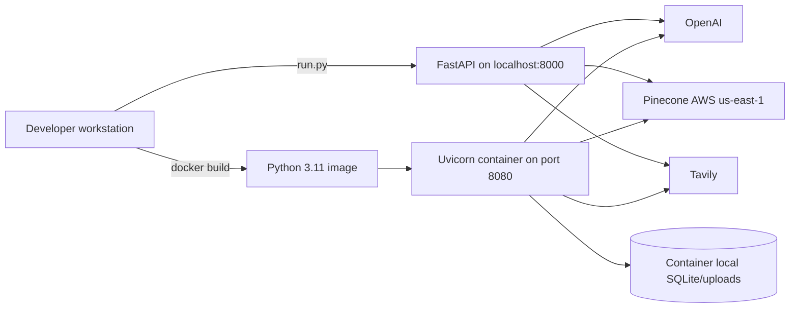

## 27. DevOps architecture

`requirements.txt` pins direct package versions, and the Dockerfile builds the
application image. CI build/test/release pipelines, branch protections,
deployment approvals, rollback automation, image scanning, and Git branching
conventions are **Not found in codebase**. README instructions are manual.

Release risks include lack of a checked-in lockfile, unverified provider/model
configuration per environment, missing `.dockerignore`, local-only persistence,
and limited automated tests.

## 28. Infrastructure architecture

| Resource | Evidence |
|---|---|
| Application host | Local Python/Uvicorn or Docker container. Hosting platform not found. |
| Network | Outbound calls to OpenAI, Pinecone, and Tavily. VPC, subnets, firewall, private endpoints not found. |
| Vector database | Pinecone serverless configured with AWS `us-east-1`, cosine metric. |
| Relational/audit storage | SQLite on local filesystem. |
| File storage | Local `uploads/` and `data/sample_kb/`. |
| Load balancer/API gateway | Not found in codebase. |
| Infrastructure as code | Not found in codebase. |
| Secrets manager | Not found in codebase. |

## 29. Testing architecture

The current workspace contains `tests/test_vectorstore.py` with two unit tests:
index creation and connection under mocked Pinecone calls, and preservation of
an existing index when dimensions mismatch. No end-to-end, browser, contract,
load, security, or provider integration tests are found in the repository
inventory. The README mentions a `tests/test_ingestion.py` file, but that file
is not present in the current inventory.

Recommended next coverage: API validation/auth/upload tests; file-loader and
chunking tests; graph branch tests with mocked LLM/retriever/search; audit
schema/insert tests; deployment smoke test for `/api/health`; prompt injection,
upload-limit, and failure-path tests.

## 30. Data lineage

| Data | Source | Transformations | Storage / destination | Consumer |
|---|---|---|---|---|
| Sample knowledge | `data/sample_kb/` files | Loader, chunker, OpenAI embedding | Pinecone namespace | Retrieval and answer generation |
| Uploaded knowledge | Browser multipart file | Suffix check, local save, loader, chunker, embedding | `uploads/` and Pinecone | Retrieval and answer generation |
| User question | Browser JSON | Pydantic validation, route/grade/rewrite prompts | External providers; question/source/trace in SQLite | Chat answer and audit |
| Web results | Tavily response | Flattened result text and citation metadata | In-memory graph state | Grading and web answer |
| Agent trace | Graph nodes | Append human-readable trace strings | Browser response and SQLite JSON | User transparency and audit |
| Generated answer | OpenAI response | Returned in API/UI | Response only; not written to audit DB | Employee |

Retention, deletion propagation from Pinecone, and personal-data classification
are **Not found in codebase**.

## 31. Requirement traceability matrix

Business requirements below are taken from the README's stated demo goals, not
from a separate approved requirements artifact.

| Business need | Feature/API | Service / external dependency | Persistence | Test coverage |
|---|---|---|---|---|
| Answer company IT questions from trusted knowledge | `POST /api/chat` | `ask` -> graph -> retriever -> OpenAI/Pinecone | Vectors in Pinecone; audit row | No chat integration test found. |
| Use current public information when private evidence is weak | Chat fallback | `search_web`, grader -> Tavily/OpenAI | No web response persistence | No workflow test found. |
| Avoid unsupported answers | Evidence grading and insufficient node | `EvidenceGrade`, OpenAI | Trace audit only | No grading tests found. |
| Improve weak retrieval query | Rewrite/retry branch | `rewrite_query` -> graph -> OpenAI | In-memory state | No retry test found. |
| Let authorized staff add company files | `POST /api/ingest` | Ingestion service -> embeddings -> Pinecone | Local upload and vectors | No ingest endpoint test found. |
| Expose service health | `GET /api/health` | FastAPI handler | None | No health test found. |
| Retain basic support trace | Chat route | Audit service -> SQLite | `query_audit` | No audit test found. |

There is no repository layer between routes/services and persistence; database
traceability is direct to SQLite or Pinecone.

## 32. Architecture decision records

No formal ADR files are found. The following are inferred implementation
decisions; rationale/alternatives are not recorded in code.

| Decision observed | Problem addressed | Trade-off / alternatives not recorded |
|---|---|---|
| LangGraph state machine | Control route/retrieve/grade/fallback/retry decisions. | More calls/state complexity than a single retrieve-and-generate chain. |
| Private KB before web | Prefer company-specific knowledge and limit unnecessary public search. | Weak evidence adds latency and provider cost. |
| Pinecone serverless, cosine, AWS `us-east-1` | Managed vector search with configured embedding vectors. | Region/index provisioning and cost controls remain operator concerns. |
| OpenAI chat and embeddings | Shared provider for reasoning and vectorization. | Provider dependency; README still has older Groq/HuggingFace references. |
| SQLite audit | Minimal local persistence for question/source/trace. | Single-host local durability/scaling limitations. |
| Inline prompts and environment settings | Keep current demo implementation simple. | No prompt versioning or per-environment schema enforcement. |

## 33. Production readiness assessment

Qualitative code-review scores only; these are not test or operational
measurements.

| Dimension | Score / 10 | Reason |
|---|---:|---|
| Security | 3 | Shared admin key with insecure default; upload controls and rate limits absent. |
| Performance | 3 | No measurements, timeouts, or bounded upload size; several sequential LLM calls. |
| Observability | 2 | Basic logs and audit rows; no metrics/tracing/alerts. |
| Reliability | 3 | No provider retry/circuit breaker; local SQLite; broad 500 path. |
| Scalability | 2 | Local persistence/uploads and no worker or multi-instance design. |
| Maintainability | 5 | Modules are separated by concern, but prompts/config and route orchestration are coupled. |
| Testability | 4 | Index tests use mocks; broader tests are absent. |

Before production: replace defaults, add identity and upload protections, define
retention, add health/readiness and telemetry, configure timeouts/retries,
externalize persistent files/audit storage, add CI and tests, harden Docker
context, and establish deployment/backup/incident procedures.

## 34. Incident response playbooks

1. **API not starting:** inspect Uvicorn output; check import errors, package
   installation, `AUDIT_DB_PATH` write permissions, and `init_db()`.
2. **Chat returns 500:** inspect server logs and response detail; verify
   `OPENAI_API_KEY`, then Pinecone key/index/dimension/namespace; determine
   whether the path used Tavily and verify `TAVILY_API_KEY`.
3. **No private-KB answers:** confirm sample/upload ingestion ran, index and
   namespace match, embedding model dimension matches, and Pinecone contains
   vectors. Do not recreate/delete a populated index blindly.
4. **Ingestion returns 401:** verify the running process loaded the expected
   `ADMIN_API_KEY`; restart after environment changes; send the value in
   `X-Admin-Key`.
5. **Ingestion fails:** check suffix, local upload-directory permissions,
   parsing errors, provider credentials, index dimension, and provider
   connectivity. Confirm whether an uploaded local file remains after failure.
6. **Audit failures:** verify `AUDIT_DB_PATH`, disk availability, and SQLite
   file permissions; note that chat currently returns 500 if audit insertion
   fails.
7. **No telemetry available:** collect timestamp, route, sanitized request
   context, app logs, provider status, and SQLite health manually. Avoid
   recording secrets or sensitive document contents.

Metrics, tracing, dashboard, alerting, and automated runbooks are **Not found in
codebase**.

## 35. New engineer onboarding guide

- **Day 1:** Read this file and the README; trace `app/main.py`,
  `app/api/routes.py`, `app/rag/workflow.py`, and `app/rag/state.py`.
- **Day 2:** Create the virtual environment, configure local environment
  variables securely, start with `run.py`, and verify `/api/health`.
- **Day 3:** Use mocked/unit tests; inspect audit schema and trace a chat request
  through graph branches without exposing real credentials.
- **Day 4:** Read `vectorstore.py` and `ingestion.py`; test supported formats,
  chunk metadata, Pinecone dimension configuration, and error paths.
- **Day 5:** Make a small tested feature, such as a health check test or
  bounded upload validation; update API and architecture documentation.

Do not run sample ingestion against a shared Pinecone index without confirming
the configured index/namespace and intended data ownership.

## 36. Knowledge transfer

Most important files: `app/main.py` for process setup; `app/api/routes.py` for
HTTP behavior; `app/rag/workflow.py` and `state.py` for graph control;
`app/rag/vectorstore.py` for dimensions and Pinecone; `ingestion.py` for file
parsing; `config.py` for environment values; `audit.py` for local persistence.

Before changes, understand the distinction between the LLM model and embedding
model, ensure Pinecone dimension compatibility, identify which prompt/data is
sent to external providers, and check whether local state or external vectors
will be affected. Treat uploaded files and `.env` as sensitive runtime data.

## 37. Engineering interview questions

### Architecture questions

1. What are the application process boundaries?
2. Which state is stored in LangGraph versus SQLite?
3. Why is the workflow built as a conditional graph?
4. What is initialized at import time?
5. Which provider clients are lazy?
6. What happens when private evidence is graded weak?
7. How is the retry budget applied?
8. How is the Pinecone namespace selected?
9. How are embedding dimensions validated?
10. Which component owns audit persistence?
11. Is there a repository abstraction?
12. What is the effect of module-global vector-store caching?
13. How does document metadata reach citations?
14. Which operations block the chat request?
15. What is the difference between health and readiness here?
16. What changes would be needed for multiple API replicas?
17. How do UI and API communicate?
18. Which parts of the README diverge from runtime code?
19. What state is local versus managed externally?
20. Which architectural assumptions need formal ADRs?

### System design questions

1. How would you make ingestion safe for large files?
2. How would you design document deletion across disk and Pinecone?
3. How would you separate tenant data?
4. How would you replace SQLite for multi-instance deployment?
5. How would you provide durable audit retention?
6. How would you add authentication and role-based ingestion?
7. How would you add request quotas?
8. How would you make provider calls resilient?
9. How would you expose streaming responses?
10. How would you partition and migrate vector indexes?
11. How would you prevent duplicate ingestion?
12. How would you support multiple embedding models?
13. How would you add a background ingestion queue?
14. How would you manage source freshness?
15. How would you enforce citation quality?
16. How would you handle regional availability?
17. How would you deploy with zero downtime?
18. How would you implement safe rollback?
19. How would you add per-user conversation state?
20. Which SLOs would you define and how would you measure them?

### AI engineering questions

1. How does `RouteDecision` constrain routing output?
2. How is evidence sufficiency determined?
3. What are the failure modes of LLM-based grading?
4. How would you evaluate route accuracy?
5. How would you measure answer faithfulness?
6. What data enters the private-KB prompt?
7. What data enters the web-answer prompt?
8. How could retrieved prompt injection be mitigated?
9. How should context size be bounded?
10. Why is temperature set to zero?
11. How does top-k affect quality and cost?
12. Why is there no reranker?
13. How would you add a reranker and evaluate it?
14. How would you handle model deprecation?
15. How can the rewrite loop be tested?
16. How would you avoid needless web calls?
17. How would you measure citation correctness?
18. What is the risk of generating answers for greeting routes with an LLM?
19. How can embedding model changes be migrated safely?
20. What offline and online evaluation datasets are needed?

### Production support questions

1. What does `/api/health` actually verify?
2. Where are chat errors converted to HTTP 500?
3. What credentials are required for an internal-KB-only query?
4. What additional credential is needed for web fallback?
5. How can an index dimension mismatch be diagnosed?
6. Does the app delete an incompatible index?
7. What happens if SQLite is unwritable?
8. Where are uploaded originals stored?
9. What happens when a filename is uploaded again?
10. What is the maximum accepted upload size?
11. How are PDF parsing errors surfaced?
12. How can one confirm the correct namespace is queried?
13. Which trace values appear in the UI?
14. Where can a failing chat be correlated with an audit row?
15. What logs and metrics are available?
16. What is the current web retry policy?
17. Which endpoint requires `X-Admin-Key`?
18. What default admin-key risk exists?
19. How is the Docker container started and on which port?
20. Which operational controls are still missing?

## 38. Architecture diagram index

The diagrams in this document cover system context (section 3), HLD (4), LLD
(5), startup (7), request (8), data flow (9), AI interactions (11), RAG (12),
agent flow (13), MCP absence (14), security boundary (19), error flow (20),
and deployment (26). The dependency graph is in section 16. An MCP execution
diagram is intentionally not fabricated because no MCP implementation exists.

## 39. Executive architecture summary

The repository implements a single-process FastAPI web application that serves
a browser UI and three API routes. Chat requests enter a compiled LangGraph
workflow, which routes simple conversation directly or retrieves from Pinecone,
grades evidence, optionally searches Tavily, rewrites a weak query once by
default, and generates a grounded answer through OpenAI. Uploaded PDF, text,
Markdown, and DOCX files are saved locally, chunked, embedded, and added to
Pinecone. Chat question/source/trace records are written to local SQLite.

The code is a demonstration foundation, not a complete production platform.
There is a Dockerfile but no cloud deployment/IaC, CI pipeline, identity
provider, rate limiting, service-level objective, distributed tracing, or
multi-instance persistence design in the repository. Provider failures,
security hardening, upload limits, retention, and deployment operations need
explicit design and tests before production use.
